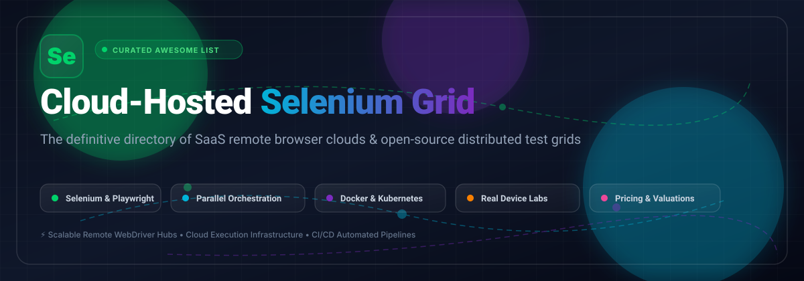

  

# 🌐 Awesome-Cloud-Hosted-Selenium-Grid 🚀

  
  
  
  
  
  

---

## 🧭 Curated Directory of Cloud-Hosted Selenium Grid Solutions & Remote Browser Infrastructure

> A comprehensive, SEO-optimized, community-maintained collection of the best **Cloud-Hosted Selenium Grids**, **commercial SaaS cross-browser testing clouds**, and **open-source Kubernetes/Docker grid orchestrators**. Designed for QA engineers, SDETs, DevOps leads, and test automation architects executing parallel Selenium, Playwright, Puppeteer, and Appium suites at scale.

**Last updated: March 2026** 📅

This repository tracks high-performance **SaaS platforms** and robust **open-source projects** dedicated to **Cloud-Hosted Selenium Grid** architecture. Modern web applications require testing against hundreds of browser engines, operating systems, and viewport permutations. These solutions provide centralized WebDriver and CDP routing endpoints that scale on-demand, eliminate local hardware bottlenecks, parallelize CI/CD test pipelines, and offer deep session telemetry (video recording, step logs, DOM snapshots, network HAR captures).

---

## 📑 Table of Contents
- [📊 Sector Overview & Market Dynamics](#-sector-overview--market-dynamics)
- [☁️ SaaS & Hosted Selenium Grid Platforms](#️-saas--hosted-selenium-grid-platforms)
- [🛠️ Open-Source GitHub Projects](#️-open-source-github-projects)
- [🤝 How to Contribute](#-how-to-contribute)
- [💖 Support](#-support)
- [⭐ Star History](#-star-history)
- [⚠️ Disclaimer](#️-disclaimer)

---

## 📊 Sector Overview & Market Dynamics

The global cloud testing and remote browser execution market is estimated at approximately **$2.0 billion to $2.2 billion** (with broader Testing-as-a-Service exceeding **$14 billion**), projected to grow at a CAGR of 8–12%. The sector exhibits a **hybrid structure**: while the broader tooling ecosystem is moderately fragmented across regional providers and emerging open-source orchestration utilities, commercial enterprise-grade cloud Selenium grid infrastructure is **heavily concentrated** around a few dominant market leaders holding significant moats in real-device farm scale, security certifications, and CI/CD ecosystem integrations.

---

## ☁️ SaaS & Hosted Selenium Grid Platforms

Commercial cloud grids eliminate infrastructure overhead by providing hosted hubs, auto-scaling browser fleets, and real device labs behind secure encrypted tunnels. The table below is sorted by **Company Scale** (Valuation / Revenue descending):

| 🏢 Product | 📈 Company Scale (Valuation / Revenue) | 📝 Description | 💳 Starting Tier Pricing | 🎁 Free Tier / Trial Limits |
|---|---|---|---|---|
| **[BrowserStack Selenium Grid](https://www.browserstack.com/)** | ~$4.0B valuation / ~$230M ARR | Cloud Selenium grid with access to 3,000+ real desktop browsers and mobile devices. Point existing WebDriver scripts at BrowserStack's remote hub. | **$59/month** (billed annually) or $79/mo for 1 parallel desktop Chrome test ($99/mo for all desktop browsers) | **Free trial**: 60 minutes of automated browser testing (max 1 hour per session); permanent free tier for approved open-source projects |
| **[Sauce Labs Selenium Grid](https://saucelabs.com/)** | ~$613M valuation / ~$120M–$150M ARR | Cloud grid supporting Selenium, Playwright, Appium, and Espresso with Virtual Device Cloud and Real Device Cloud. | **$149/month** (billed annually) or $199/mo for 1 parallel test (Virtual Device Cloud, unlimited test minutes) | **Free trial**: 28-day trial with 60 total automated & live testing minutes across up to 3 parallel VMs |
| **[LambdaTest Selenium Grid](https://www.lambdatest.com/)** | ~$400M valuation / ~$30M–$40M ARR | Scalable cloud Selenium grid with 3,000+ browser/OS combinations. Features HyperExecute AI orchestration for parallel execution. | **$79/month** (billed annually) or $99/mo for 1 parallel Desktop Web automation test | **Free forever plan**: 60 minutes/month automated browser testing with 1 concurrent session (resets monthly); 15-day trial of real device cloud |
| **[Experitest Grid](https://experitest.com/)** | Digital.ai parent: ~$140M–$230M ARR (Experitest ~$25M revenue at acquisition) | Enterprise mobile & cross-browser continuous testing grid (SeeTest) integrated into the Digital.ai DevOps platform. | **$250/device slot per month** for SaaS unmetered remote testing; custom enterprise contract | **Free evaluation**: 14-day to 30-day guided evaluation with up to 600 free device testing minutes upon request |
| **[TestGrid Selenium Grid](https://testgrid.io/)** | Bootstrapped / Pre-Series A (~$2M–$5M ARR est.) | AI-powered test automation platform with real devices, cloud browsers, and agentic self-healing capabilities. | **$199/seat per month** (CoTester Starter package) | **Free evaluation**: 14-day guided proof-of-concept (PoC) evaluation with dedicated engineering onboarding |
| **[TestingBot Grid](https://testingbot.com/)** | Bootstrapped / ~$500K–$1M ARR est. | Cloud Selenium grid featuring 6,100+ browser/OS combinations and real iOS/Android devices with video recordings and automated logs. | **$50/month** (billed annually) or $70/mo for 1 parallel test and 1,000 automated minutes/month | **Free trial**: 14-day free trial with 60 total minutes across real devices and desktop browsers |
| **[Gridlastic](https://www.gridlastic.com/)** | Bootstrapped / Micro-SaaS | Dedicated, auto-scaling Selenium grid on AWS infrastructure with spot instance support and encrypted local tunnels. | **$795/month** (Professional tier: 25 parallel nodes, ~15,000 credits/approx. 70k–150k minutes) | **Free forever plan**: 5 free grid starts per month, up to 2 parallel nodes, max 2 hours per session run |
| **[Moon by Aerokube (Cloud)](https://aerokube.com/moon/)** | Bootstrapped / <$1M ARR est. | Kubernetes-native browser automation grid supporting Selenium, Playwright, Puppeteer, and Cypress with Helm deployment. | **$5/parallel session per month** | **Free forever plan**: Up to 4 parallel browser sessions without license key; unlimited free evaluation keys via Moon Assistance Program |

---

## 🛠️ Open-Source GitHub Projects

Self-hosted and containerized Selenium grid solutions for platform engineering and QA teams building private cloud infrastructure. Sorted by **GitHub_Stars** (descending):

| 📦 Project | ⭐ GitHub_Stars | 📖 Description |
|---|---|---|
| **[SeleniumHQ/selenium](https://github.com/SeleniumHQ/selenium)** |  | The official core browser automation framework and reference Selenium Grid 4 architecture featuring Router, Distributor, SessionMap, EventBus, and Appium relay. |
| **[browserless/browserless](https://github.com/browserless/browserless)** |  | Modern web service for running remote headless browsers. Supports WebDriver/Selenium, Playwright, and Puppeteer with Docker, Kubernetes, and horizontal auto-scaling. |
| **[SeleniumHQ/docker-selenium](https://github.com/SeleniumHQ/docker-selenium)** |  | Official Docker images and Kubernetes Helm charts for distributed Selenium Grid 4 nodes (Chrome, Firefox, Edge) with KEDA auto-scaling support. |
| **[aerokube/selenoid](https://github.com/aerokube/selenoid)** |  | Lightweight Go-based daemon that launches isolated browser containers in Docker per session. (Archived; evaluate Moon or WebSummoner for modern migrations). |
| **[zalando/zalenium](https://github.com/zalando/zalenium)** |  | Pioneer Docker and Kubernetes Selenium Grid with on-demand scaling, live VNC preview, and video recording dashboard. (Archived). |
| **[elgalu/docker-selenium](https://github.com/elgalu/docker-selenium)** |  | Popular all-in-one containerized Selenium Grid node with Chrome, Firefox, Xvfb, VNC server, and video recording capabilities. |
| **[aerokube/ggr](https://github.com/aerokube/ggr)** |  | Go Grid Router: high-performance load balancer used to route Selenium WebDriver traffic across multiple independent Selenoid or Selenium Grid clusters. |
| **[aerokube/selenoid-ui](https://github.com/aerokube/selenoid-ui)** |  | Graphical web dashboard for Selenoid and Moon. Displays active browser sessions, live VNC streams, screen resolution switching, and saved session videos. |
| **[aerokube/moon](https://github.com/aerokube/moon)** |  | Kubernetes and OpenShift native browser automation platform. Runs ephemeral browser pods per test session with zero maintenance overhead. |
| **[aerokube/cm](https://github.com/aerokube/cm)** |  | Configuration Manager CLI tool for effortless single-command installation, updating, and configuration of Selenoid and Selenoid-UI. |
| **[wrike/callisto](https://github.com/wrike/callisto)** |  | Kubernetes-native open-source implementation of Selenium Grid created by Wrike for scalable ephemeral browser pod management. |
| **[alcounit/selenoid4k8s](https://github.com/alcounit/selenoid4k8s)** |  | Selenoid adaptation designed to launch on-demand, disposable browser pods inside Kubernetes clusters. |
| **[WebSummoner/websummoner](https://github.com/WebSummoner/websummoner)** |  | Modern Go-based, Apache-2.0 Selenoid successor providing ephemeral Docker container sessions and Selenoid protocol compatibility. |

---

## 🤝 How to Contribute

Contributions are warmly welcome! Help keep this curated list accurate and up-to-date:

1. 🍴 **Fork** this repository.
2. 🌿 Create a new feature branch (`git checkout -b feature/add-new-grid`).
3. ✏️ Add or update entries in `README.md` following the existing format.
4. 🔍 Ensure links are active, descriptions are concise and factual, and pricing/star data is verified.
5. 🚀 Submit a **Pull Request** with a brief summary of your addition.

---

## 💖 Support

Thank you for exploring and utilizing this curated directory! If you find this project valuable for your testing workflows, please consider supporting it:

- ⭐ **Star** this repository on GitHub to boost its visibility for the QA and automation community.
- 🍴 **Fork** and share it with your teammates, DevOps leads, and testing groups.
- ☕ **Sponsor the project & buy a coffee**: Support ongoing curation and maintenance via the [Sponsor Dashboard](https://github.com/sponsors/ishandutta2007).

---

## ⭐ Star History

---

## ⚠️ Disclaimer

- This repository is an independent, community-curated list and does not constitute an official endorsement of any listed tool or commercial platform.
- Remote Selenium and WebDriver endpoints execute arbitrary browser commands; always enforce secure authentication tokens, firewall rules, and ephemeral container cleanup when operating public or self-hosted grid infrastructure.
- All product names, logos, and brands are property of their respective owners.

---

  <b>Built with ❤️ for QA Engineers, SDETs, Platform Teams, and Automation Architects worldwide.</b>

